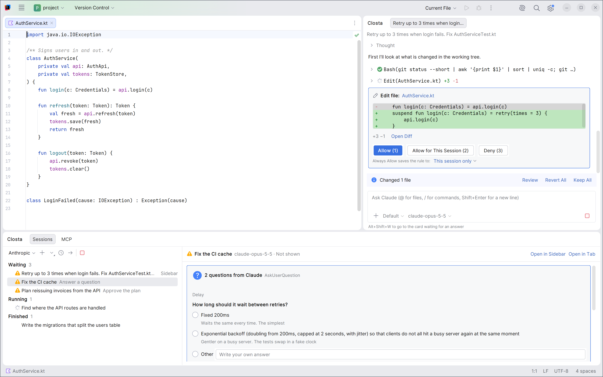
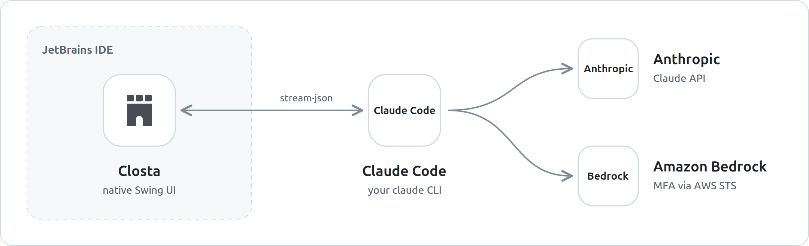

<picture>
  <source media="(prefers-color-scheme: dark)" srcset="jetbrains/src/main/resources/META-INF/pluginIcon_dark.svg">
  
</picture>

# Closta

**Claude CodeをJetBrains IDEでネイティブに動かすプラグイン。AnthropicとAmazon Bedrockに対応**

[English](README.md) | 日本語

<picture>
  <source media="(prefers-color-scheme: dark)" srcset=".github/assets/screenshot-dark.png">
  
</picture>

この文書は[英語版](README.md)の抄訳です。内容が食い違うときは英語版に従ってください。

Clostaはインストール済みのClaude Code CLI（`claude`）を動かし、会話をIDEのSwingの部品で表示します。編集はdiffで、1ターン分の変更はVCSの変更で、承認はカードで見せます。webviewは使いません。

- 会話はClostaツールウィンドウかエディタのタブで開き、いくつでも並べられる
- ツールの許可・ファイルの編集（diff）・計画・質問をカードで表示し、その場で答える
- 1ターン分の変更を、VCSの変更としてIDEのdiffでまとめて開く
- 下のClostaウィンドウに、待っている・動いている・終わったセッションとMCPサーバーを並べる
- IDEのどこからでも、待っている次のセッションへ移る
- メッセージから巻き戻す・分岐する、保存した会話を再開する
- 信頼したプロジェクトでは、新しいgit worktreeで会話を始める
- 認証は`claude`コマンドのサインインか、MFAコードを使うAmazon Bedrock。秘密はIDEのパスワードセーフに置く

## 仕組み

<picture>
  <source media="(prefers-color-scheme: dark)" srcset=".github/assets/architecture-dark.png">
  
</picture>

Clostaは会話ごとに`claude`のプロセスを1つ起動し、stdinとstdoutだけでやり取りします。会話は`claude`からAnthropicへ送られます。
Bedrockを選んだときの送り先はAmazon Bedrockです。Closta自身が呼ぶのは、Bedrockの一時認証情報を取るAWS STSだけです。

## 必要なもの

- IntelliJ IDEA 2026.2以降（2026.2.4と2026.3で検証済み、build 262+）。上限は設けておらず、ビルドごとにPlugin Verifierで推奨のIDEを検査している
- [Claude Code](https://docs.claude.com/ja/docs/claude-code/setup) CLI（`claude`）。Clostaには同梱していないので、インストールして`PATH`に置く
- `claude`でのサインインか、Claudeモデルを使えるAmazon Bedrockのアカウント。Bedrockも同じ`claude`を通して使う

## インストール

1. [Releases](https://github.com/ukitomato/closta/releases)から`closta-<version>.zip`を取得する
2. IDEで「Settings | Plugins」を開き、歯車から「Install Plugin from Disk…」を選んでzipを指定する
3. IDEを再起動する

ダウンロードを確かめるには、同じリリースの`SHA256SUMS`をzipの隣に置いて`sha256sum -c SHA256SUMS`を実行します。

右側のClostaツールウィンドウを開くか、「Tools | Closta | Closta: New Conversation」で会話を始めます。
IDEが日本語で動いているときは画面も日本語になります。

## キー

| キー | 場所 | 動作 |
| --- | --- | --- |
| Ctrl+Alt+Shift+O | どこでも | エディタのタブで新しい会話 |
| Ctrl+Alt+Shift+Period | どこでも | 待っている次のセッションへ |
| Enter / Shift+Enter | 入力欄 | 送信 / 改行 |
| Esc | 入力欄 | 返答を止める |
| Shift+Tab | 入力欄 | 権限モードを切り替える |
| Alt+K | 入力欄 | エディタの選択範囲を`@path#L5-10`で挿入 |
| Alt+Shift+W | 入力欄 | 答えを待っているカードへ |
| `@` | 入力欄 | ファイル名を補完 |

## 設定

「Settings | Tools | Closta」で設定します。

| プロバイダ | 設定 |
| --- | --- |
| Anthropic（既定） | `claude`コマンドのサインイン（`claude` → `/login`）を使う。モデルは任意で指定 |
| Amazon Bedrock | リージョン・MFAデバイスのARN・長期アクセスキー |

Bedrockでは、セッション開始時にMFAコードを聞き、AWS STSから一時認証情報を取ります。`aws`コマンドも`~/.aws`も要りません。
WSLで`#com.intellij.execution`のデバッグログを有効にすると、`idea.log`にCLIへ渡すAWSの一時認証情報が出ることがあります。そのログは共有しないでください。

## ライセンス

[Apache License 2.0](LICENSE)。Clostaは個人のプロジェクトで、Anthropic・JetBrains・Amazon Web Services・Kotlin Foundationとは関係がなく、承認も受けていません。ClaudeとClaude CodeはAnthropicの、IntelliJ IDEAはJetBrainsの、Amazon BedrockとAWSはAmazon.com, Inc.またはその関連会社の、KotlinはKotlin Foundationの商標です。これらの名前は、互換性を説明するためだけに使っています。
