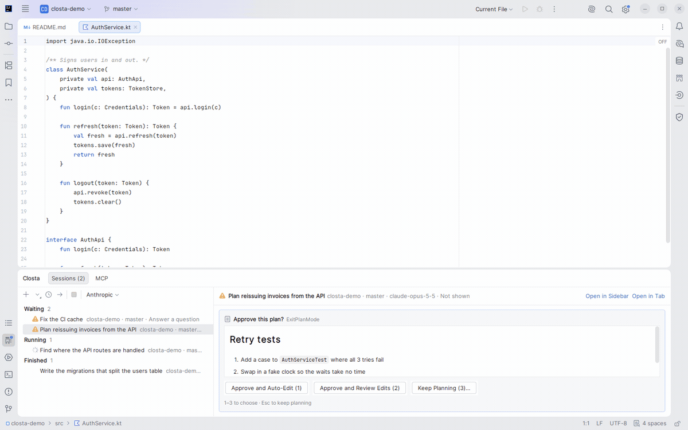
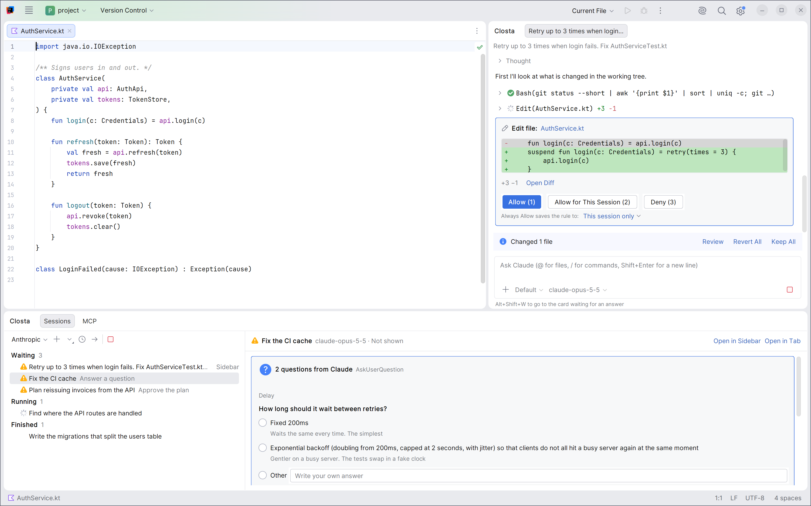
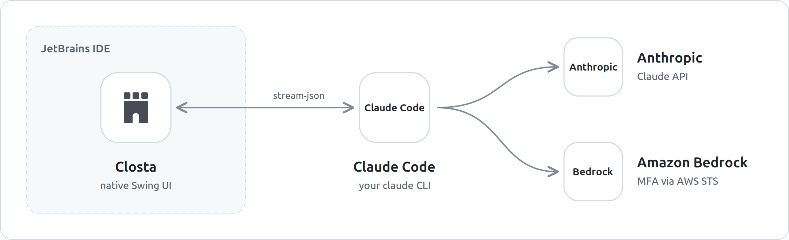

<picture>
  <source media="(prefers-color-scheme: dark)" srcset="jetbrains/src/main/resources/META-INF/pluginIcon_dark.svg">
  
</picture>

# Closta

**A third-party JetBrains IDE plugin for using Claude Code with a native UI.**

English | [日本語](README.ja.md)

Closta runs the Claude Code CLI you have installed and shows the conversation in the IDE's own Swing components:
edits as diffs, a turn's changes as VCS changes, approvals as cards. No webview.

<picture>
  <source media="(prefers-color-scheme: dark)" srcset=".github/assets/demo-dark.gif">
  
</picture>

<!-- Plugin description -->
A third-party plugin that runs your `claude` CLI (Claude Code) and shows it in a native IDE UI. Not affiliated with Anthropic.

- Conversations in the Closta tool window or in editor tabs, several at a time.
- Tool permissions, file edits (as diffs), plans and questions as cards, answered in place.
- A turn's changes as VCS changes, opened in the IDE's combined diff.
- A Closta window at the bottom with every session (what waits, what runs, what finished) and the MCP servers.
- A jump to the next session that waits for you, from anywhere in the IDE.
- Rewind and fork from a message, and resume saved conversations.
- In a trusted project, start a conversation in a new git worktree.
- The `claude` command's own sign-in, or Amazon Bedrock with an MFA code. Secrets stay in the IDE's password safe.

**Requirements:** the [Claude Code](https://docs.claude.com/en/docs/claude-code/setup) CLI (`claude`) installed and on
your `PATH`; Closta does not bundle it. Sign in with `claude`, or use an Amazon Bedrock account with access to Claude
models.

**Getting started:** open the **Closta** tool window on the right, or choose **Tools | Closta | Closta: New
Conversation**. Amazon Bedrock is set up in **Settings | Tools | Closta**.

[Report a problem](https://github.com/ukitomato/closta/issues) ·
[Ask a question](https://github.com/ukitomato/closta/discussions)
<!-- Plugin description end -->

## More features

<picture>
  <source media="(prefers-color-scheme: dark)" srcset=".github/assets/screenshot-dark.png">
  
</picture>

- The `+` of a window opens a new conversation in that window; its ▾ menu chooses an editor tab, the sidebar or a
  new git worktree.
- The **Sessions** tab answers permissions, questions, plans and edits in its detail pane. The **MCP** tab turns the
  servers on or off and reconnects them.
- A turn's changes can be reverted or kept all at once.
- Rewind goes back to before a message: the conversation only, or the files too.
- Esc stops a reply. A session whose tab you close keeps running; Sessions stops it or opens it again.
- The provider switch next to the `+` chooses the provider new conversations start with. A running conversation keeps
  its provider.
- Model, effort and permission mode can be switched while the conversation runs. Images and PDFs can be attached.
- A project opened from `\\wsl$\…` runs `claude` inside that distribution, where it must be installed.
- The UI is in English, and in Japanese when the IDE runs in Japanese.

## How it works

<picture>
  <source media="(prefers-color-scheme: dark)" srcset=".github/assets/architecture-dark.png">
  
</picture>

- Closta starts one `claude` process per conversation and talks to it only over stdin and stdout. What the agent may
  do is decided by `claude` and its permission mode; Closta shows the requests and sends your answers.
- The conversation goes from `claude` to Anthropic, or to Amazon Bedrock when that provider is chosen. Closta itself
  calls only AWS STS, to get Bedrock's temporary credentials.
- An in-process MCP server gives the agent the diagnostics the IDE has already found.

## Install

Requires IntelliJ IDEA 2025.3 or later (verified on 2025.3.6 and 2026.2.4; build 253+) and the
[Claude Code](https://docs.claude.com/en/docs/claude-code/setup) CLI. Amazon Bedrock runs through the same `claude`
command, so it is needed with either provider.

1. Download `closta-<version>.zip` from [Releases](https://github.com/ukitomato/closta/releases).
2. In the IDE, open **Settings | Plugins**, click the gear icon, choose **Install Plugin from Disk…**, and pick the zip.
3. Restart the IDE.

To check the download, run `sha256sum -c SHA256SUMS` next to the zip, with the `SHA256SUMS` file from the same release.

## Keys

All commands are under **Tools | Closta**.

| Key | Where | What it does |
| --- | --- | --- |
| Ctrl+Alt+Shift+O | Anywhere | New conversation in an editor tab |
| Ctrl+Alt+Shift+Period | Anywhere | Next waiting session |
| Enter / Shift+Enter | Message box | Send / new line |
| Esc | Message box | Stop the reply |
| Shift+Tab | Message box | Change the permission mode |
| Alt+K | Message box | Insert the editor's selection as `@path#L5-10` |
| Alt+Shift+W | Message box | Go to the card waiting for an answer |
| `@` | Message box | Complete a file name |

## Configuration

**Settings | Tools | Closta**

- **Anthropic** (default): uses the `claude` command's own sign-in (`claude` → `/login`). Optionally set a model.
- **Amazon Bedrock**: an IAM user's long-term access keys and MFA device. See [Amazon Bedrock](#amazon-bedrock) below.

**Settings | Tools | Closta | Behaviour** sets whether unsaved files are saved before a message is sent, whether `@`
file completion leaves out ignored files, and the permission mode new conversations start in.

### Amazon Bedrock

Closta signs in to Bedrock as an IAM user with an MFA device. Nothing needs the `aws` command or `~/.aws`.

What you need from AWS:

- An IAM user with an MFA device (virtual or hardware) and a long-term access key (`AKIA…`).
- An IAM policy that lets that user invoke the Claude models, and the models enabled in your region. See
  [Claude Code on Amazon Bedrock](https://docs.claude.com/en/docs/claude-code/amazon-bedrock).

To set it up:

1. Open **Settings | Tools | Closta**, click **+** and choose **Amazon Bedrock**.
2. Fill in the fields and click **Apply**.

   | Field | Value |
   | --- | --- |
   | Name | Any name, shown in the provider switch and the sign-in prompt |
   | AWS region | Such as `us-east-1`. Used for both STS and Bedrock |
   | MFA device | The ARN of a virtual device (`arn:aws:iam::123456789012:mfa/name`) or the serial number of a hardware one |
   | Session duration (seconds) | 900 to 129600 (15 min to 36 h). Default 43200 (12 h) |
   | Access key ID / Secret access key | The IAM user's long-term key. Kept in the IDE's password storage and never shown again |
   | Model (optional) | The model `claude` starts with |
   | Sonnet model ID / Haiku model ID | Inference profile IDs or ARNs to use in place of `claude`'s defaults |

3. Set **Provider for new sessions** to the new provider, or choose it with the provider switch next to the `+` of a
   Closta window.

When a conversation starts, Closta asks for a code from your MFA device and calls STS `GetSessionToken`. The temporary
credentials are kept in the password storage and reused by later conversations until 15 minutes before they expire.
When they expire in the middle of a conversation, use **Restart Session** and enter a new code.

`claude` gets the region and the temporary credentials as environment variables. From the IDE's own environment,
Closta does not pass on `AWS_PROFILE`, `AWS_BEARER_TOKEN_BEDROCK`, `CLAUDE_CODE_SKIP_BEDROCK_AUTH`, the other
providers' switches or the Anthropic credentials. `ANTHROPIC_BEDROCK_BASE_URL`, proxy settings and model variables are
passed on.

If the IDE keeps passwords in memory only, the long-term keys are lost when the IDE exits. Choose KeePass or the
system keychain in **Settings | Appearance & Behavior | System Settings | Passwords**.

Under WSL, with debug logging on for `#com.intellij.execution`, `idea.log` can contain the temporary AWS credentials
passed to the CLI. Do not share such a log.

## Contributing

Issues and pull requests are welcome. [CONTRIBUTING.md](CONTRIBUTING.md) covers building from source, the
architecture and the performance budgets the tests hold. Security issues: see [SECURITY.md](SECURITY.md).

## License

[Apache License 2.0](LICENSE). Third-party notices are in [NOTICE](NOTICE).

Closta is an independent project. It is not affiliated with or endorsed by Anthropic, JetBrains, Amazon Web Services or the Kotlin Foundation. Claude and Claude Code are trademarks of Anthropic. IntelliJ IDEA is a trademark of JetBrains. Amazon Bedrock and AWS are trademarks of Amazon.com, Inc. or its affiliates. Kotlin is a trademark of the Kotlin Foundation. These names are used only to describe compatibility.
